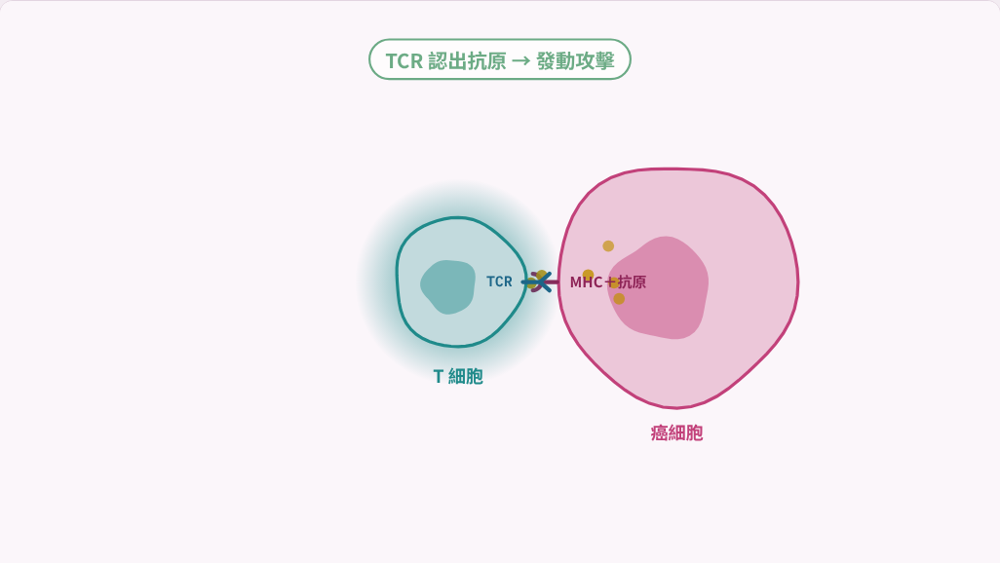
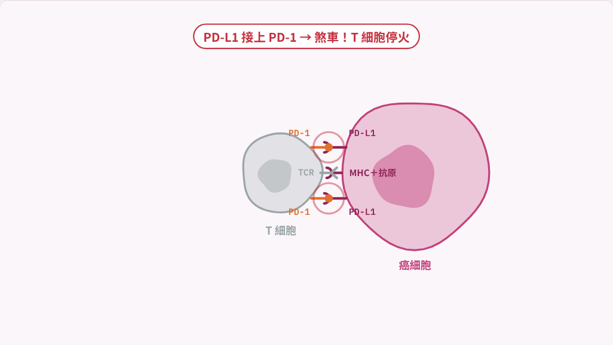
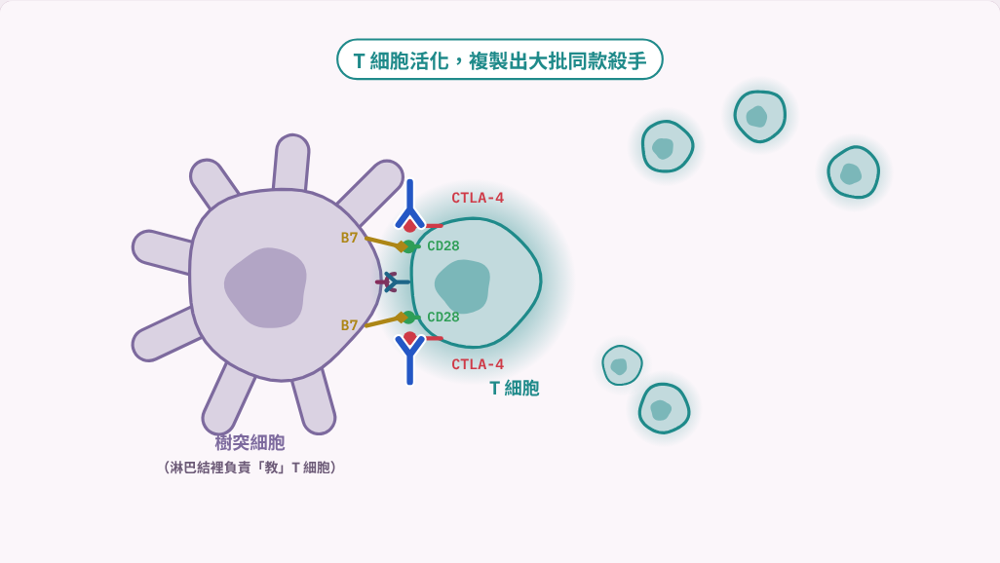
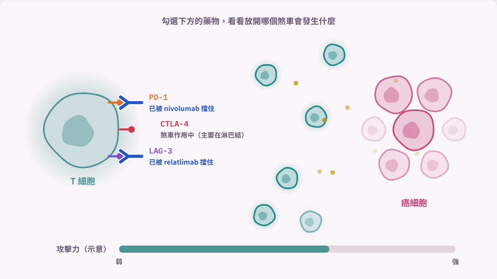
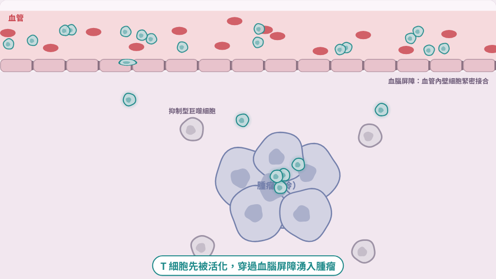
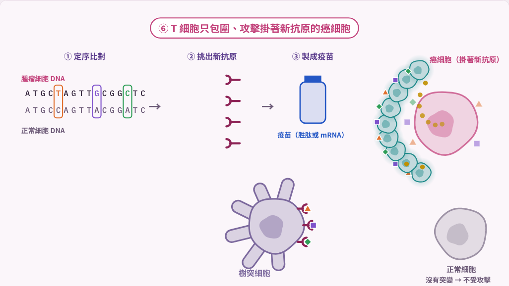

# 放開免疫的煞車：Scolyer 對腦癌的實驗

用六幕互動動畫，解說免疫檢查點抑制劑與個人化癌症疫苗的原理。案例是澳洲病理學家 Richard Scolyer 用免疫療法治療自己的膠質母細胞瘤。

**開啟方式**：下載 `index.html`，用瀏覽器打開即可（需要網路載入字型）。

## 新聞摘要

- **兩位諾貝爾獎得主**：James Allison 發現 CTLA-4、本庶佑發現 PD-1。這兩個受體都是 T 細胞的「煞車」，兩人因此獲得 2018 年諾貝爾生理醫學獎。根據他們的發現開發出的藥物，稱為「免疫檢查點抑制劑」。
- **Richard Scolyer**：澳洲黑色素瘤病理學家。2023 年 6 月確診膠質母細胞瘤，成為全世界第一位在手術前接受三藥合併免疫治療的腦癌病人，三種藥是 nivolumab（抗 PD-1）、ipilimumab（抗 CTLA-4）、relatlimab（抗 LAG-3）。他另外也接受了依照自己腫瘤基因製作的個人化癌症疫苗。
- **後續**：2024 年和同事 Georgina Long 共同獲選「澳洲年度人物」。2025 年 3 月腫瘤復發，2026 年 6 月 7 日過世，享年 59 歲。
- **注意**：這是單一病例，無法證明療法有效，仍需要臨床試驗確認。

## 六幕內容

| 幕 | 主題 | 互動 |
|---|---|---|
| 1 | T 細胞怎麼殺死癌細胞（TCR 對上 MHC＋抗原） | 播放、拖曳時間軸 |
| 2 | PD-1 煞車與 nivolumab | 開關藥物，比較用藥前後 |
| 3 | CTLA-4 煞車與 ipilimumab（在淋巴結啟動 T 細胞） | 開關藥物，比較用藥前後 |
| 4 | 三藥合併（PD-1、CTLA-4、LAG-3） | 自己勾選藥物組合 |
| 5 | 血腦屏障、冷腫瘤，以及術前用藥的道理 | 術前給藥、手術切除 |
| 6 | 個人化癌症疫苗：定序 → 新抗原 → 疫苗 → 訓練 T 細胞 | 播放、拖曳時間軸 |

## 截圖

| | |
|---|---|
|  |  |
|  |  |
|  |  |

## 資料來源

- [Wikipedia：Richard Scolyer](https://en.wikipedia.org/wiki/Richard_Scolyer)
- [The Scientist：Richard Scolyer dies at 59](https://www.the-scientist.com/cancer-researcher-and-pathologist-richard-scolyer-dies-at-59-74605)
- [NSW Government：Passing of Richard Scolyer](https://www.nsw.gov.au/ministerial-releases/passing-of-richard-scolyer)
- [MJA InSight：Scolyer 的腦癌研究遺產](https://insightplus.mja.com.au/2026/23/richard-scolyer-leaves-a-unique-legacy-of-pioneering-brain-cancer-research)
- [Nature Medicine 2025：Neoadjuvant triplet immune checkpoint blockade in newly diagnosed glioblastoma](https://pubmed.ncbi.nlm.nih.gov/40779733/)
- [RNZ 2024：Scolyer 公布治療一年後的結果](https://www.rnz.co.nz/news/world/516784/australian-of-the-year-richard-scolyer-blown-away-by-success-of-radical-new-brain-cancer-treatment)
- [AAP：Melanoma expert patient zero in brain cancer fight](https://aapnews.aap.com.au/news/melanoma-expert-patient-zero-in-brain-cancer-fight)
- [Nature 2018：膠質母細胞瘤個人化新抗原疫苗一期試驗](https://www.doi.org/10.1038/S41586-018-0792-9)
- [UCLA Health：術前雙藥免疫治療與膠質母細胞瘤](https://www.uclahealth.org/news/release/scientists-identify-clues-making-immunotherapy-more)

---

本專案為科普示意，動畫中的強度與數量不是臨床數據，也不構成醫療建議。
